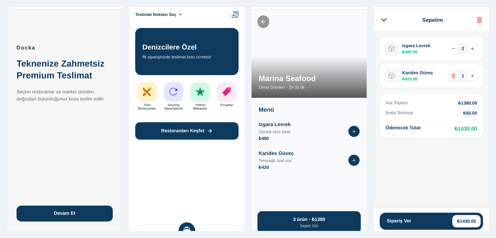

# Docka: Mobile App

Mobile app for **Docka**, an on-demand delivery service for boats. Customers anchored in a bay order meals from
nearby restaurants or groceries from a market, and a delivery boat brings the order to their location.

Expo · React Native · TypeScript · Expo Router · Zustand · react-native-maps · Supabase



## Features

- **Onboarding and service choice**: restaurant or market.
- **Delivery point on a map**: the customer shares GPS location (expo-location) and pins the boat on a map
  (react-native-maps).
- **Browse**: nearby restaurants with delivery times, restaurant menus, market categories (fresh produce, snacks, drinks, breakfast, cleaning).
- **Cart**: add and remove items, change quantities, subtotal, boat-delivery fee and total.
- **Checkout**:
  - steps: location → details → summary;
  - contact details and a charter-guest toggle;
  - boat name and notes for the delivery crew (for example, flag colour).
- **Order history** and an order-success screen.
- Tab navigation with a centre action button.

## Status

UI prototype. Menu and market data are mocked in the app, and orders live in app state. The Supabase client is
already configured for authentication and session storage, ready for the backend integration.

## Run

```bash
npm install
cp .env.example .env    # Supabase project URL + publishable (anon) key
npx expo start          # open in Expo Go, or an Android / iOS simulator
```

## Structure

```
app/                 screens (file-based routing with Expo Router)
  (tabs)/            home, restaurants, market, profile tabs
  restaurant/[id]    restaurant menu
  market/[id]        market item (placeholder)
  cart, checkout, orders, location, onboarding, select-type, success
src/
  context/           cart context
  store/             global app state (Zustand)
  lib/supabase.ts    Supabase client (AsyncStorage session)
components/          shared UI components
constants/theme.ts   colours and fonts
```

## Author

Muhammet Kaan Doğru
